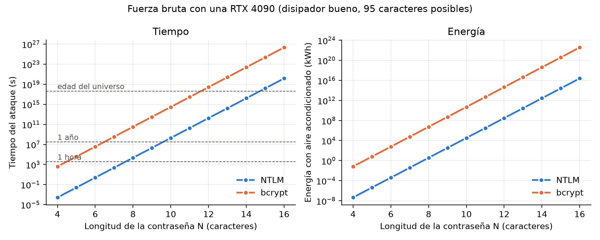

# ¿Cuánta energía cuesta romper una contraseña por fuerza bruta?

Proyecto final de **Física A: Hardware e Información** (Universidad de los Andes).
Profesor: Andrés Flórez.

**Integrantes:** Felipe Rojas Díaz · Alejandra Rodríguez · Samuel Fonseca

Simulamos una GPU que prueba contraseñas por fuerza bruta: el chip se calienta según un
balance de energía, se frena cuando supera su temperatura límite, y eso cambia cuánto
tiempo, energía y dinero cuesta el ataque. Al final comparamos con el límite
termodinámico de Landauer.

## Resultados principales

| Contraseña (NTLM, RTX 4090) | Tiempo | Energía con aire acondicionado | Costo (Enel, estrato 4) |
| --- | --- | --- | --- |
| 6 caracteres | 2.5 s | 0.0004 kWh | menos de $1 |
| 8 caracteres | 6.1 h | 3.69 kWh | $3.183 |
| 10 caracteres | 6 años | 3.3×10⁴ kWh | $28,7 millones |
| 12 caracteres | 5.7×10⁴ años | 3×10⁸ kWh | $259.256 millones |

- **La longitud gana a la complejidad:** cada carácter extra multiplica el tiempo, la energía y el costo por 95.
- **P = C·V²·f es consistente con nuestras mediciones** en dos procesadores (C = 12.0 nF con R² = 0.986, y 9.5 nF), con la recta pasando por el origen sin forzarla.
- **Medimos una GPU de verdad atacando con hashcat** (GTX 1650): 16.5 GH/s con 47 W, 2.8 nJ por intento, del mismo orden que el 1.5 nJ que usamos para la RTX 4090.
- **Frenar cambia tiempo por energía:** con un disipador malo el ataque tarda 14 % más pero gasta 17 % menos.
- **El calor es un efecto de segundo orden:** cambia el tiempo en un 14 %; la longitud de la contraseña lo multiplica por 95 por carácter.
- **Límite de Landauer:** con un computador irreversible, recorrer una llave de 256 bits exige más energía que la que emitirá el Sol en toda su vida (cota de orden de magnitud).



## Cómo correrlo

```bash
pip install -r requirements.txt
jupyter notebook proyecto.ipynb      # luego: Kernel -> Restart & Run All
```

La física también está organizada como paquete de Python en `fisica/`, con cada ecuación traducida a una
función. La tabla que conecta cada ecuación con su código está en
[`docs/ECUACIONES_A_CODIGO.md`](docs/ECUACIONES_A_CODIGO.md).

Medición propia (portátil enchufado, unos 15 minutos):

```bash
python medicion/benchmark.py --duracion 900 --nombre <tu_nombre>
```

Guarda un CSV en `medicion/datos/` con hora, hashes por segundo, temperatura y
frecuencia contra el tiempo. Después de la carga sigue registrando 5 minutos en reposo
(fase de enfriamiento). En Linux la temperatura se lee sola; en Windows hay que
registrarla en paralelo con HWiNFO64 y en macOS con `sudo powermetrics`. Los dos
archivos se unen por la columna `hora`.

Protocolo para que las mediciones sean comparables:

1. Cerrar todo (navegador, juegos, Discord) y dejar el equipo en reposo unos 5 minutos.
2. En HWiNFO: *Settings → Scan interval = 1000 ms*; abrir *Sensors-only* e iniciar el
   registro a CSV.
3. Esperar 30 s y correr `python medicion/benchmark.py --duracion 900 --nombre <nombre>_<modo>`.
4. No tocar el equipo hasta que termine (unos 20 min). Detener el registro de HWiNFO.
5. Guardar los dos archivos en `medicion/datos/` como `<nombre>_<modo>_benchmark.csv` y
   `<nombre>_<modo>_hwinfo.csv`.

## Panel de la presentación

`presentacion/panel.html` es una sola página para mostrar en la sustentación. Arriba se escribe una
contraseña de prueba y la página dice, en una frase, cuánto tardaría una RTX 4090 en probarlas todas, cuánto
costaría en la factura y cómo cambia el tiempo con la longitud. Abajo, lado a lado y con el mismo reloj:

- **El modelo:** la RTX 4090 simulada con el mismo Euler y los mismos frenos del notebook. En "Ajustar el
  modelo" se cambian el disipador, la temperatura del cuarto, el tope de potencia y el tipo de freno.
- **Lo que medimos:** nuestras mediciones reproducidas al mismo ritmo. Por defecto, la GTX 1650 atacando con
  hashcat; también están las CPU de Felipe y de Alejandra, o se puede abrir cualquier CSV del benchmark.

La temperatura grande cambia de color de azul a rojo a medida que el chip se calienta.

**Cómo probarlo:** doble clic en `presentacion/panel.html`, escribir una contraseña y darle a *Iniciar*
(la barra espaciadora también sirve). Funciona sin internet; con internet usa las tipografías del diseño.

**Modo en vivo** (la GPU atacando durante la sustentación), en dos terminales:

```bash
python presentacion/servidor.py            # luego abrir http://localhost:8000
python medicion/gpu_benchmark.py --hashcat "C:\hashcat-8.0.0\hashcat-8.0.0\hashcat.exe" --duracion 900 --nombre demo
```

El panel detecta la medición en curso y la muestra sola, marcada como "midiendo en vivo".

Si se cambian los datos o la plantilla, se regenera con `python presentacion/generar_panel.py`.

## Medición de la GPU

`medicion/gpu_benchmark.py` corre hashcat (NTLM, `-m 1000`) contra un hash inventado y registra cada segundo
la velocidad, la temperatura, la potencia, la frecuencia y el motivo de frenado (nvidia-smi). Se usa en Windows,
fuera de cualquier máquina virtual, con HWiNFO registrando en paralelo para obtener el voltaje de la GPU.
Primero conviene hacer una prueba con `--duracion 60`.

## Material para la sustentación

- `docs/Guia_de_repaso.pdf`: 20 páginas para entender el proyecto completo (teoría, método, mediciones, resultados), con las preguntas probables de la sustentación y qué gráficas poner en el póster.
- `docs/Chuleta_fisica.docx`: 4 páginas, una ficha por ecuación del curso (qué dice, cómo la usamos, nuestro número). Es lo que hay que tener a mano frente al póster.
- `docs/Fisica_del_proyecto_completo.docx`: 11 páginas con las derivaciones completas y las figuras, por si preguntan de dónde sale una ecuación.

## Estructura

```
proyecto.ipynb        Entregable: ensayo computacional (texto + código + interpretación)
medicion/
  benchmark.py        Bucle de hashes en paralelo que registra velocidad vs. tiempo
  gpu_benchmark.py    Ataque real con hashcat en una GPU NVIDIA + registro de nvidia-smi
  EQUIPOS.md          Hardware de cada integrante y qué medición puede hacer cada equipo
  datos/              CSV medidos por nosotros (qué es cada archivo: datos/README.md)
figuras/              Gráficas exportadas para el póster
fisica/               La física del notebook como paquete: térmico, potencia, frenado, ataque, Landauer
docs/                 Ecuaciones → código, chuleta de física y documento completo
presentacion/
  panel.html          Panel para la sustentación (se abre con doble clic)
  panel_plantilla.html  Fuente del panel (sin datos)
  generar_panel.py    Incrusta las mediciones en la plantilla
  servidor.py         Sirve el panel con modo en vivo en http://localhost:8000
requirements.txt      Librerías: numpy, matplotlib, ipywidgets, psutil (opcional)
```

Todo el modelo y el integrador están dentro del notebook, para que cada ecuación
esté junto a su código y su interpretación.

## Plan

- [x] **Fase 1** — Balance de energía, Euler propio, validación con solución analítica,
      convergencia (orden 1) y estabilidad (Δt > τ oscila, Δt > 2τ diverge)
- [x] **Fase 2** — Frenado con dos frenos (tope de potencia y límite térmico, on/off vs.
      proporcional), P(φ) calibrada con la medición, validación del equilibrio por bisección,
      τ efectivo con freno, y acoplamiento con el ataque (T, intentos y energía con Euler)
- [ ] **Fase 3** — Medición propia con `benchmark.py` y HWiNFO, ajuste de τ con la curva de
      enfriamiento
  - [x] Felipe, modo Silencio (τ ≈ 44 s, R_th ≈ 1.2 K/W)
  - [x] Felipe, modos Rendimiento y Turbo (Turbo: +22 % velocidad, +30 % energía por hash;
        P = C·V²·f confirmado con C ≈ 12 nF en los tres modos)
  - [x] Alejandra, modos Silencio y Rendimiento (5.9 µJ/hash, C ≈ 9.5 nF, R_th ≈ 2 K/W,
        freno térmico observado; τ de calentamiento ≈ 10 s vs. enfriamiento ≈ 33 s)
  - [ ] Samuel: ThinkPad T14 (i7-1185G7, solo CPU) en dos modos
  - [x] GPU del TUF de Felipe (GTX 1650) con hashcat 8.0: 16.5 GH/s en NTLM, 47 W, 2.8 nJ por
        intento, frenada por potencia; calentamiento con dos escalas de tiempo (6 s y ~210 s)
  - [ ] GPU del Omen de Samuel (RTX 4060 Laptop), opcional
- [x] **Fase 4** — Costo en pesos (Enel, estrato 4), barridos de R_th y T_amb, límite de
      Landauer (≈ 215 bits / 33 caracteres aleatorios superan la energía del Sol en su vida)
- [ ] **Fase 5** — Notebook como ensayo
  - [x] Limitaciones y conclusiones (borrador para revisar entre los tres)
  - [ ] Declaración de uso de IA: completar qué hizo cada integrante
  - [x] "Restart & Run All" corre sin errores
- [ ] **Fase 6** — Presentación
  - [x] Demo interactiva (sección 13)
  - [x] Panel de la sustentación con modo en vivo (`presentacion/`)
  - [ ] Póster
  - [ ] Ensayo de la sustentación
